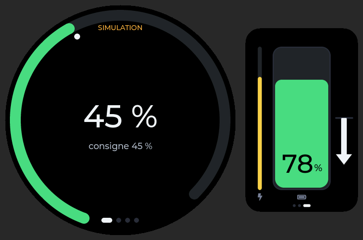

# KHÉPRI — écrans pilote (ESP-IDF 5.5, LVGL 8.3)

Deux écrans côte à côte sur le tableau de bord, chacun avec un rôle fixe :

| Écran | Carte | Rôle | Dossier |
|---|---|---|---|
| **Rond 1,75"** | Waveshare ESP32-S3-Touch-AMOLED-1.75 (466×466) | commande et effet : jauge de régime, consigne, alertes | [`ecran_rond_1.75/`](ecran_rond_1.75/) |
| **Rectangulaire 1,64"** | Waveshare ESP32-S3-Touch-AMOLED-1.64 (280×456, portrait) | énergie : batterie, solaire, bilan | [`ecran_energie_1.64/`](ecran_energie_1.64/) |

Forme différente = nature différente : rond = moteur, rectangle = énergie. Pas de changement de
page en vol, mêmes couleurs sur les deux écrans, rien d'affiché quand tout va bien.



Les deux écrans **se trouvent tout seuls au démarrage** et se parlent en ESP-NOW (filaire plus
tard, peut-être). Le rond reçoit la télémétrie du maître et la relaie à l'écran énergie. **Seul
l'écran énergie va sur le Wi-Fi** : il se met à jour depuis ce dépôt, et pousse au rond ses
mises à jour par ESP-NOW.

## Arborescence

```
ecran_rond_1.75/      projet ESP-IDF de l'écran rond (main.c, khepri_screen.c, gestes knob.c…)
ecran_energie_1.64/   projet ESP-IDF de l'écran énergie (main.c, energie_screen.c), cartes V1 / V1.1
components/           commun aux deux écrans et à la passerelle
  kh_common/          liaison avec le maître (khepri_link), entre écrans (kh_peer), Wi-Fi (kh_wifi),
                      mises à jour (kh_ota : GitHub, et rond ← énergie par ESP-NOW)
  kh_fonts/           polices Montserrat 14-64 px + thème de couleurs (kh_theme.h)
  khepri_proto/       protocole ESP-NOW, trames CAN, modèle, calcul d'autonomie, simulation (C pur)
  lvgl/, esp-now/, cmake_utilities/, esp_lcd_sh8601/, i2c_bsp/, qmi8658/
gateway_sim/          passerelle de simulation (rôle du maître) + khepri_relay à copier dans le maître
release/              binaires publiés et manifestes OTA (voir ci-dessous)
tools/                publier_maj.py, aperçus PC (tools/preview)
tests/                tests PC (protocole, modèle, autonomie, gestes)
docs/apercus/         images des deux écrans (rond/, energie/, cote_a_cote.png)
```

## Premier flash par USB (une seule fois par écran)

| Écran | Fichier à flasher à l'adresse 0x0 |
|---|---|
| Rond 1,75" | `release/ecran_rond/khepri_ecran_rond_1.75_0x0.bin` |
| 1,64" révision V1 (sérigraphie en haut) | `release/ecran_energie/khepri_ecran_energie_1.64_V1_0x0.bin` |
| 1,64" révision V1.1 (sérigraphie à droite) | `release/ecran_energie/khepri_ecran_energie_1.64_V1.1_0x0.bin` |
| Passerelle de simulation (tout ESP32-S3) | `release/passerelle/khepri_passerelle_simulation_0x0.bin` |

```
python -m esptool --chip esp32s3 -p COM11 -b 460800 write-flash 0x0 <fichier>
```

ou https://espressif.github.io/esptool-js/ (Chrome/Edge). Le flash USB écrit aussi la table de
partitions ; ensuite tout passe par le Wi-Fi de l'écran énergie.

- **Écran énergie** : le flash USB de la 1.1.0 ajoute la partition `fw_rond` (4 Mo) où il range
  l'image du rond. Un écran énergie mis à jour par Wi-Fi depuis la 1.0.0 garde l'ancienne table :
  ça marche quand même (il range alors l'image du rond dans sa partition OTA libre).
- **Écran rond** : un rond en 1.4.1 ou 1.5.0 connecté au Wi-Fi passe seul en 1.6.0 (l'ancien
  manifeste `release/version.json` reste tenu à jour). À partir de la 1.6.0, il ne va plus sur le
  Wi-Fi : ses mises à jour arrivent par l'écran énergie.

## Mises à jour OTA

Seul l'écran énergie est connecté au Wi-Fi (page RÉGLAGES → Wi-Fi). Toutes les 60 s :

1. **Lui-même** : il lit `release/ecran_energie/version.json` (champ `url_V1` ou `url_V1.1` selon
   sa carte) ; si la version diffère de la sienne, il télécharge l'image, l'écrit dans son autre
   partition et redémarre.
2. **L'écran rond** : il lit `release/ecran_rond/version.json` et compare avec la version que le
   rond lui annonce. Si elle diffère :
   - il télécharge l'image dans sa partition `fw_rond` et en vérifie le SHA-256 ;
   - il la **propose** au rond, qui n'accepte que moteurs arrêtés et sans alerte (sinon : « prête,
     arrêter les moteurs », nouvel essai toutes les 10 s) ;
   - il l'**envoie par ESP-NOW** (bibliothèque esp-now OTA, paquets acquittés et reprise des
     manquants) ; le rond l'écrit dans sa partition libre, affiche la progression en plein écran,
     puis redémarre dessus. 3 essais au plus par version.

Les deux écrans gardent le retour arrière : une version qui ne tient pas 20 s est abandonnée au
profit de l'ancienne. L'état est affiché dans RÉGLAGES (écran énergie) et en bas de SYSTÈME
(écran rond). Le CDN de GitHub garde les fichiers jusqu'à 5 min.

**Publier :**

```
# 1. augmenter set(PROJECT_VER "...") dans ecran_rond_1.75/CMakeLists.txt et/ou ecran_energie_1.64/CMakeLists.txt
python tools/publier_maj.py tout --compiler     # ou rond / energie / passerelle
git add -A release ecran_* && git commit -m "écrans : …" && git push
```

Le dépôt est public et les images ne sont pas signées ; le rond n'arme la réception par ESP-NOW
qu'après une proposition de son écran énergie, mais n'importe quel émetteur esp-now OTA proche
pourrait alors lui envoyer une image. À verrouiller (branche protégée, Secure Boot, chiffrement
ESP-NOW) avant un usage en vol.

## Liaison entre les deux écrans

Rien à faire : à la mise sous tension, chaque écran annonce son rôle ; le premier écran de l'autre
rôle entendu à moins de −75 dBm (côte à côte) devient son partenaire jusqu'au prochain démarrage
(bouton RÉAPPAIRER sur l'écran énergie pour en changer).

- **rond → énergie** : la télémétrie que le rond reçoit du maître, ou sa simulation (SIMU) ;
  l'écran énergie affiche donc la même chose, et suit la consigne réglée au roulis sur le rond.
- **énergie → rond** : état du Wi-Fi et des mises à jour (bas de la page SYSTÈME), puis les
  mises à jour elles-mêmes.

**Canal radio.** Connecté à un point d'accès, l'écran énergie passe sur le canal de ce point
d'accès. Le rond, s'il n'a pas de maître (ou est en SIMU) et n'entend plus l'écran énergie,
parcourt les canaux pour le retrouver (« recherche (canal N) » en bas de SYSTÈME). Lié à un vrai
maître, il reste sur le canal du maître : le Wi-Fi de l'écran énergie est donc pour le sol.

**Tester** : flasher les deux écrans, les poser côte à côte, allumer. Le rond démarre en SIMU :
l'écran énergie affiche SIMULATION et sa flèche de bilan bouge quand on roule le rond.

## Liaison ESP-NOW (`components/khepri_proto/include/khepri_espnow.h`)

1. **Appairage avec le maître** : LIER sur l'écran rond, à quelques centimètres du maître. Le rond
   est initiateur `espnow_ctrl` (attribut `KEY_7`) ; il retient en NVS le premier maître qui lui
   envoie de la télémétrie et ignore ensuite les autres. L'écran énergie n'a pas besoin de se
   lier au maître : le rond lui relaie tout.
2. **Télémétrie maître → écrans** (10 Hz) : trames CAN telles quelles — SYNC 0x600, chaussettes
   0x601-0x605 et 0x621-0x625, BSR Drive `Get_Encoder_Estimates` (0x009) et
   `Get_Bus_Voltage_Current` (0x017) des axes 0 et 1, **énergie 0x680 (batterie : SOC, U, I, Wh) et
   0x681 (solaire : W par aile, crête installée)** calculées par le maître à partir de l'EMUS G1 et
   des MPPT Victron.
3. **Commandes écran → maître** (mot de 32 bits) : `1` acquittement d'alarme, `2` REPÈRE,
   `3` enregistrement, `4` battement de cœur 1 Hz, `5` consigne de régime en ‰ (rond seulement).

`gateway_sim/main/khepri_relay.c` est fait pour être copié dans le firmware du maître :
`khepri_relay_init()` après le Wi-Fi, puis `khepri_relay_push(id, data, dlc)` pour chaque trame.

## Tests et aperçus sur PC

```
make -C tests && ./tests/test_proto && ./tests/test_knob
make -C tools/preview && ./tools/preview/preview docs/apercus/rond && ./tools/preview/preview_energie docs/apercus/energie
```
