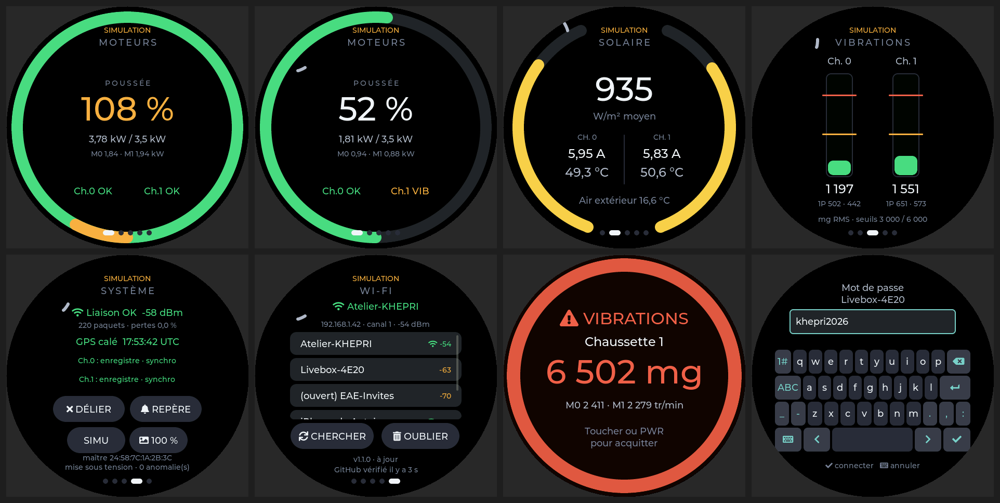

# KHÉPRI — écran pilote (Waveshare ESP32-S3-Touch-AMOLED-1.75)

Firmware ESP-IDF 5.5 de l'écran rond 1,75" (466×466, CO5300) qui affiche au pilote l'état de la
motorisation, de la cellule solaire témoin et des vibrations des deux chaussettes. Il reprend
l'architecture de `bsr_screen` (télécommande BSR sur AMOLED 1,64") : LVGL 8.3 en pages, liaison
ESP-NOW avec appairage par bouton et commandes 32 bits.



## Pages

| Page | Contenu |
|---|---|
| MOTEURS | Jauge unique de poussée sur tout le pourtour, départ en bas : 100 % = 3,5 kW électriques (M0 + M1, réglable `KHEPRI_THRUST_REF_W`) ; au-delà, second tour ambre. Puissance totale et par moteur, état vibratoire des chaussettes |
| SOLAIRE | Ensoleillement moyen (W/m²) ; Isc et température de cellule par chaussette ; air extérieur |
| VIBRATIONS | RMS vectoriel par chaussette, repères 3 000 / 6 000 mg, amplitudes 1P M0 · M1 |
| SYSTÈME | Liaison radio, heure GPS, état et défauts des chaussettes ; LIER/DÉLIER, REPÈRE, SIMU, luminosité |
| WI-FI | Réseaux à portée (balayage), saisie du mot de passe au clavier tactile, réseau mémorisé, OUBLIER ; version et état des mises à jour |
| Alerte | Plein écran rouge sur trame ALARME niveau 2 ; acquittée au toucher ou au bouton PWR, puis 30 s de silence pour cette chaussette |

Une donnée plus vieille que 3 s s'affiche `---`. Le bandeau du haut indique LIAISON OK,
LIAISON PERDUE, NON APPAIRÉ ou SIMULATION.

## Entrées

- **Tactile** : glisser entre les pages, boutons de la page SYSTÈME.
- **Bouton PWR** (TCA9554 P4) : acquitte l'alerte, sinon revient à MOTEURS. Un appui long reste
  géré par l'AXP2101 (extinction).
- **Molette provisoire par l'accéléromètre QMI8658** (`main/knob.c`), en attendant le moteur BLDC
  encodeur :
  - carte tenue debout : tourner la carte comme un bouton, un cran tous les 20° → page suivante ou
    précédente ;
  - carte à plat : l'accéléromètre ne voit pas la rotation autour de la verticale, on passe en
    manette : incliner à droite ou à gauche de plus de 15° fait un cran, puis répète.
  Un petit trait sur le pourtour montre la position de la molette (ambre en mode manette).
  C'est une approximation : en vol, les accélérations de l'avion la perturbent. L'encodeur BLDC
  n'aura qu'à appeler `kh_screen_knob_step()` à la place.

## Wi-Fi et mises à jour OTA

**Connexion.** Page WI-FI : la liste se remplit à l'arrivée sur la page (CHERCHER pour relancer).
Toucher un réseau ouvre le clavier ; ✓ connecte, l'icône clavier annule. Le réseau est mémorisé
en NVS et rejoint à chaque démarrage. OUBLIER efface les identifiants.

**Mises à jour automatiques.** Quand l'écran est connecté, il lit toutes les 60 s
`https://raw.githubusercontent.com/bluesmart-robotics/khepri/main/IHM/code/release/version.json`.
Si la version annoncée diffère de la sienne (`PROJECT_VER`), il télécharge
`release/khepri_ecran_app.bin` en HTTPS, l'écrit dans l'autre partition (ota_0 / ota_1) et
redémarre. Si la nouvelle version ne tient pas 20 s sans planter, le chargeur revient à l'ancienne.

- Jamais pendant que les moteurs tournent ou qu'une alerte est affichée : la mise à jour attend.
- Le CDN de GitHub garde les fichiers jusqu'à 5 min : une publication est vue en 1 à 6 min.
- Toucher la ligne de version force une vérification immédiate.
- Le dépôt est public et l'image n'est pas signée : quiconque peut pousser sur `main` peut
  installer un firmware sur les écrans connectés. À verrouiller (branche protégée, Secure Boot)
  avant un usage en vol.

**Publier une version.**

```
# 1. augmenter set(PROJECT_VER "...") dans IHM/code/CMakeLists.txt
idf.py build
python tools/publier_maj.py        # copie l'image, régénère release/version.json et le .bin complet
git add release CMakeLists.txt && git commit -m "écran v1.1.1" && git push
```

**Wi-Fi et ESP-NOW partagent la radio.** Connecté à un point d'accès, l'écran passe sur le canal
de ce point d'accès. Si ce n'est pas le canal du maître (1 par défaut), la liaison avec l'avion
est coupée, et la page WI-FI l'indique. Le Wi-Fi est prévu pour le sol.

## Liaison ESP-NOW (`components/khepri_proto/include/khepri_espnow.h`)

Bibliothèque `espressif/esp-now`, comme la télécommande BSR :

1. **Appairage** : page SYSTÈME → LIER, écran à quelques centimètres du maître. L'écran est
   initiateur `espnow_ctrl` avec l'attribut `KEY_7` (la télécommande BSR utilise `KEY_1` : les deux
   ne peuvent pas se lier entre eux). Le maître accepte au-dessus de −55 dBm. L'écran retient en NVS
   l'adresse du premier maître qui lui envoie de la télémétrie, puis ignore les autres.
2. **Télémétrie maître → écran** : paquets `ESPNOW_DATA_TYPE_DATA` de 10 Hz contenant les trames CAN
   telles quelles (en-tête `KH` de 8 octets, puis id/dlc/données, 20 trames au plus). L'écran
   décode les mêmes octets que sur le bus : SYNC 0x600, chaussettes 0x601-0x605 et 0x621-0x625,
   `Get_Encoder_Estimates` (0x009) et `Get_Bus_Voltage_Current` (0x017, P = U·I) des axes 0 et 1 du BSR Drive (`kp_frames.h` = sous-ensemble de `kp_can.h`).
3. **Commandes écran → maître** : mot de 32 bits, code dans le quartet de poids fort :
   `1` acquittement d'alarme (chaussette), `2` REPÈRE (n°), `3` enregistrement on/off,
   `4` battement de cœur 1 Hz.

### Côté maître

`gateway_sim/main/khepri_relay.c` est fait pour être copié dans le firmware du maître :
`khepri_relay_init()` après le démarrage du Wi-Fi, puis `khepri_relay_push(id, data, dlc)` pour
chaque trame CAN reçue et pour la SYNC émise. Le relais garde la dernière valeur de chaque
identifiant et n'envoie qu'aux écrans appairés. **Attention** : le Wi-Fi du maître sert aussi au
rapatriement des fichiers (point d'accès sur un canal tiré au hasard) ; l'écran doit être sur le
même canal (`KHEPRI_ESPNOW_CHANNEL`). À arbitrer avant intégration.

## Passerelle de simulation (`gateway_sim/`)

Joue le rôle du maître sur n'importe quel ESP32-S3 (par exemple la carte 1,64") : trames simulées,
passées par `khepri_relay`, alarme vibratoire de la chaussette 1 toutes les 90 s.

## Mode simulation de l'écran

Actif au premier démarrage (`KHEPRI_DEMO_DEFAULT`) : l'écran génère lui-même ses données et
affiche SIMULATION. Bouton SIMU de la page SYSTÈME pour l'arrêter ; le choix est mémorisé.
**À désactiver avant tout vol.**

## Compiler et flasher

```
idf.py build                       # ESP-IDF 5.5, aucun composant à télécharger
idf.py -p COMx flash monitor
cd gateway_sim && idf.py build flash   # passerelle
```

Sans ESP-IDF : flasher `release/khepri_ecran_1.75_0x0.bin` à l'adresse 0x0, par exemple
`python -m esptool --chip esp32s3 -p COM11 -b 460800 write-flash 0x0 release/khepri_ecran_1.75_0x0.bin`
ou avec https://espressif.github.io/esptool-js/ (Chrome/Edge, IDE Arduino fermé).
Le premier flash par USB est obligatoire (nouvelle table de partitions OTA) ; ensuite, les mises à
jour passent par le Wi-Fi.

Réglages (`idf.py menuconfig` → « KHEPRI - ecran pilote ») : canal ESP-NOW, simulation au
démarrage, angle d'un cran et sens de la molette, nœuds CANSimple des moteurs.

## Tests et aperçus sur PC

```
make -C tests && ./tests/test_proto && ./tests/test_knob
make -C tools/preview && ./tools/preview/preview docs/apercus
```

## Arborescence

```
main/                 écran : main.c (CO5300, LVGL, tâches), khepri_screen.c (UI),
                      khepri_link.c (ESP-NOW), kh_wifi.c (Wi-Fi), kh_ota.c (mises à jour),
                      knob.c (molette), kh_board.c (CST9217, TCA9554)
release/              binaires publiés : version.json (manifeste OTA), image OTA, images complètes 0x0
components/
  khepri_proto/       protocole ESP-NOW, trames CAN, modèle, simulation (C pur)
  lvgl/               LVGL 8.3.11 (copie de bsr_screen, sans exemples ni démos)
  esp-now/, cmake_utilities/, esp_lcd_sh8601/   copies locales des composants Espressif
  i2c_bsp/, qmi8658/  repris de bsr_screen (broches I2C 14/15)
gateway_sim/          passerelle de simulation + khepri_relay (côté maître)
tests/, tools/preview/, tools/publier_maj.py
```

## Non vérifié sur matériel

Tout compile sans avertissement et les tests PC passent, mais rien n'a encore tourné sur la carte.
Points à contrôler au premier essai : affichage (pilote SH8601 utilisé avec les commandes
d'initialisation du CO5300, décalage de 6 colonnes), sens du tactile, sens et signes de
l'accéléromètre (`KHEPRI_KNOB_INVERT`), lecture du bouton PWR par le TCA9554.
