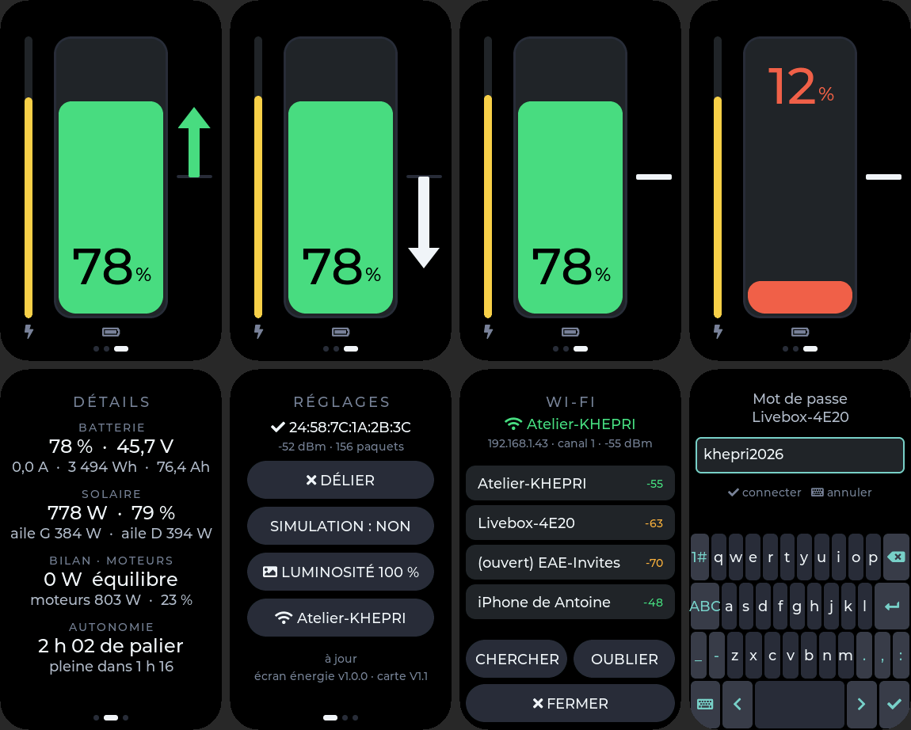

# Écran énergie 1,64" — batterie, solaire, bilan (Waveshare ESP32-S3-Touch-AMOLED-1.64)

Écran rectangulaire 280×456 en portrait (CO5300 piloté comme un SH8601, tactile FT3168), posé à
côté de l'écran rond. Il montre l'énergie **en permanence, sans changer de page en vol** ; le rond
garde le régime moteur. Il est passif : aucune commande moteur ne part d'ici.



## Page ÉNERGIE (toujours affichée en vol)

- **Au centre, la jauge de batterie** (état de charge) : verte, ambre sous 30 %, rouge sous 15 %.
  Le pourcentage est dans la jauge, toujours loin du bord de remplissage : **en bas au-dessus de
  50 %** (en noir sur la couleur), **en haut en dessous** (en blanc, ou dans la couleur d'alerte).
- **À gauche, un fin trait jaune : la production solaire.** Vide : rien ; plein : puissance crête
  installée (980 W par défaut, ou la valeur envoyée par le maître).
- **À droite, le bilan de la batterie.** Une flèche part du milieu : **vers le haut quand la
  batterie se charge** (verte), **vers le bas quand elle se vide** (blanche — consommer n'est pas
  une faute). Sa longueur suit la racine carrée du flux, même échelle dans les deux sens, pleine
  longueur à 3,5 kW : les petits flux restent visibles. Sous 25 W, pas de flèche : le trait du
  zéro s'épaissit (bilan nul, la motorisation suit le soleil).
- En haut, rien quand tout va bien ; sinon SIMULATION, LIAISON PERDUE, NON APPAIRÉ.

Le bilan est mesuré à la batterie (U × I du BMS, trame 0x680) ; sans BMS, il est déduit du
solaire moins les moteurs.

## Glisser le doigt vers la droite

1. **DÉTAILS** : SOC, tension, courant (+ en charge), Wh et Ah restants ; solaire total, % de la
   crête, par aile ; bilan en W ; puissance des moteurs ; heures de palier, temps de recharge.
2. **RÉGLAGES** : liaison (LIER / DÉLIER), simulation, luminosité, Wi-Fi (liste des réseaux et
   clavier), état des mises à jour (toucher pour vérifier), version et révision de carte.

**Retour automatique à la page ÉNERGIE après 10 s sans toucher l'écran** (60 s dans la fenêtre
Wi-Fi).

## Deux révisions de carte

| Révision | Repérage sur le PCB | Écran (LCD_CS) | Image USB à flasher en 0x0 |
|---|---|---|---|
| V1 | sérigraphie de version **en haut** | GPIO9 | `release/ecran_energie/khepri_ecran_energie_1.64_V1_0x0.bin` |
| V1.1 | sérigraphie de version **à droite**, près des connecteurs | GPIO46 | `release/ecran_energie/khepri_ecran_energie_1.64_V1.1_0x0.bin` |

Une image de la mauvaise révision donne un **écran noir** (rien de cassé : reflasher l'autre).
Ensuite, chaque écran se met à jour tout seul avec l'image de **sa** révision : le manifeste
`release/ecran_energie/version.json` porte un champ par carte (`url_V1`, `url_V1.1`).

## Compiler

```
idf.py -B build_V1.1 -D SDKCONFIG=build_V1.1/sdkconfig -D SDKCONFIG_DEFAULTS="sdkconfig.defaults;sdkconfig.V1.1" build
idf.py -B build_V1   -D SDKCONFIG=build_V1/sdkconfig   -D SDKCONFIG_DEFAULTS="sdkconfig.defaults;sdkconfig.V1"   build
```

ou, depuis `IHM/code` : `python tools/publier_maj.py energie --compiler` (compile les deux et publie).

## Réglages

`menuconfig` → « KHEPRI - ecran energie 1.64 » : simulation au démarrage, broche CS, révision.
Les réglages communs (canal ESP-NOW, batterie 4 480 Wh, solaire 980 W, palier 2 500 W,
référence 3,5 kW, OTA) sont dans « KHEPRI - commun aux ecrans » : mêmes valeurs que l'écran rond.

## Simulation autonome

Active au premier démarrage : un pilote fictif alterne moteur arrêté (charge), suivi du soleil
(bilan nul), croisière et montée (décharge), sur un cycle de 2 minutes. Pour afficher les
données du maître ou de l'écran rond, passer SIMULATION à NON puis LIER (voir le README du
dossier parent).

## Non vérifié sur matériel

Brochage, commandes d'initialisation, décalage de 20 colonnes et lecture du FT3168 sont repris de
`bsr_screen`, qui tourne sur cette carte. À contrôler au premier essai : sens du tactile (glisser),
et la PSRAM (8 Mo octale annoncés par Waveshare pour l'ESP32-S3R8 ; `bsr_screen` ne l'utilisait pas).
