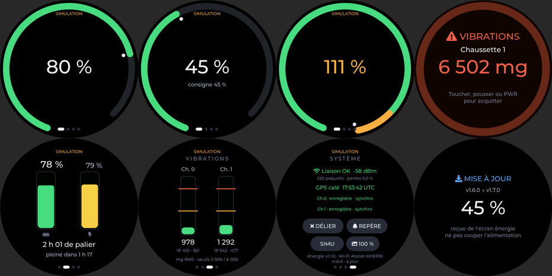

# Écran rond 1,75" — régime moteur (Waveshare ESP32-S3-Touch-AMOLED-1.75)

Écran rond 466×466 (CO5300, tactile CST9217, IMU QMI8658, extenseur TCA9554, AXP2101). Rôle :
**commande et effet** — la jauge de régime, la consigne, les alertes. L'énergie est sur l'écran
rectangulaire voisin ([`../ecran_energie_1.64`](../ecran_energie_1.64)).



## Pages

| Page | Contenu |
|---|---|
| Principale | Une seule jauge verte sur le pourtour, sens horaire : 0 % à 20° après le bas, 100 % à 45° avant le bas (100 % = 3,5 kW électriques M0 + M1, réglable `KHEPRI_THRUST_REF_W`) ; au-delà, la jauge continue en ambre jusqu'à ≈ 122 %. Au centre, le pourcentage seul. Pastille blanche = consigne de régime ; « consigne NN % » s'affiche 2 s pendant le réglage. Les chaussettes n'apparaissent qu'en cas de vibration anormale |
| Autonomie | Deux barres verticales (rien de circulaire, pour ne pas confondre avec le moteur) : à gauche l'état de charge de la batterie (vert, ambre < 30 %, rouge < 15 %), à droite la production solaire (vide = rien, pleine = puissance crête installée, 980 W par défaut). Dessous : « X h de palier » = énergie restante / (puissance de palier − production solaire), « palier illimité » si le soleil suffit ; « pleine dans X h » = énergie manquante / production. Données : trames 0x680 (batterie) et 0x681 (solaire) émises par le maître |
| VIBRATIONS | RMS vectoriel par chaussette, repères 3 000 / 6 000 mg, amplitudes 1P M0 · M1 |
| SYSTÈME | Liaison radio, heure GPS, état et défauts des chaussettes ; LIER/DÉLIER, REPÈRE, SIMU, luminosité ; en bas : écran énergie et mises à jour |
| Alerte | Plein écran rouge sur trame ALARME niveau 2 ; acquittée au toucher, par une poussée ou au bouton PWR, puis 30 s de silence pour cette chaussette |

Une donnée plus vieille que 3 s s'affiche `---`. Principe : on ne dit rien quand tout va bien. Le bandeau du haut
reste vide si la liaison est bonne et n'indique que LIAISON PERDUE, NON APPAIRÉ ou SIMULATION.

## Entrées

- **Tactile** : glisser entre les pages, boutons de la page SYSTÈME.
- **Bouton PWR** (TCA9554 P4) : acquitte l'alerte, sinon revient à MOTEURS. Un appui long reste
  géré par l'AXP2101 (extinction).
- **Gestes à l'accéléromètre QMI8658** (`main/knob.c`, 100 Hz), en attendant le bouton haptique
  (moteur BLDC). Repère, écran face à soi : Z sort de l'écran vers le pilote, X vers le haut, Y vers
  la droite.
  - **petit coup vers l'arrière** (l'écran part vers −Z) → page suivante, ou acquittement de
    l'alerte affichée ; simule l'appui du futur bouton. Seuil 120 mg, 0,6 s de temps mort ;
  - **rouler l'écran vers la droite / la gauche** (rotation dans son plan, autour de Z) → la consigne
    de régime monte / descend, de 0 à 122 %. Zone morte 3°, vitesse croissante jusqu'à 40 %/s à 13° ;
    revenir droit garde la consigne. Actif seulement sur la page principale, hors alerte.
  La consigne pilote la simulation et part vers le maître (commande `KHN_CMD_THROTTLE`, ‰ 0-1220,
  10 Hz au plus). L'écran doit être tenu à peu près debout pour lire le roulis. En vol, les
  accélérations de l'avion perturbent ces gestes : c'est une solution d'atelier.

## Fluidité

- Une seule tâche touche LVGL (cœur 1, priorité 5) ; elle revient au moins toutes les 10 ms.
- La consigne de régime va directement de la tâche des gestes à l'affichage, à chaque tour de
  boucle : le repère suit le roulis sans attendre les données.
- Les données sont rafraîchies à 20 Hz, et l'écran n'est mis à jour qu'à l'arrivée d'un nouvel
  instantané (ou toutes les 250 ms pour faire vieillir l'affichage). Seule la page visible est
  recalculée, et un widget n'est touché que si sa valeur change.
- Le petit coup vers l'arrière change de page sans animation (une seule image à dessiner) ;
  l'alerte clignote en deux états au lieu d'un fondu redessiné à chaque image.
- Le journal série donne toutes les 10 s : images/s, temps de rendu moyen et maximal.

## Écran énergie voisin

L'écran rond se lie tout seul, au démarrage, à l'écran énergie posé à côté, et lui relaie la
télémétrie (celle du maître, ou sa simulation). Il ne va plus sur le Wi-Fi : c'est l'écran
énergie qui lui apporte ses mises à jour, par ESP-NOW. Il ne les accepte que moteurs arrêtés et
sans alerte, affiche alors « MISE À JOUR · NN % » en plein écran, puis redémarre. Le bas de la
page SYSTÈME indique l'écran énergie (version, Wi-Fi) et l'état des mises à jour.

## Réglages

`idf.py menuconfig` → « KHEPRI - ecran rond 1.75 » : simulation au démarrage, seuil de poussée,
zone morte / plage / vitesse et sens du roulis. Les réglages communs aux deux écrans (canal
ESP-NOW, puissance de référence, batterie, solaire, palier, nœuds CANSimple, OTA) sont dans
« KHEPRI - commun aux ecrans ».

## Compiler

```
idf.py build                       # dans ce dossier, ESP-IDF 5.5
idf.py -p COMx flash monitor
```

## Non vérifié sur matériel

Points à contrôler au premier essai : sens et signes de l'accéléromètre (`KHEPRI_ROLL_INVERT`,
`KHEPRI_PUSH_INVERT`), lecture du bouton PWR par le TCA9554.
